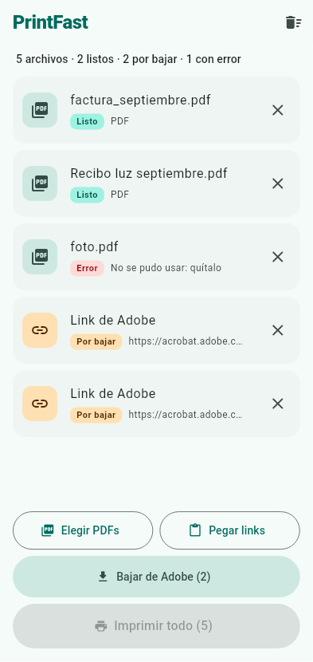
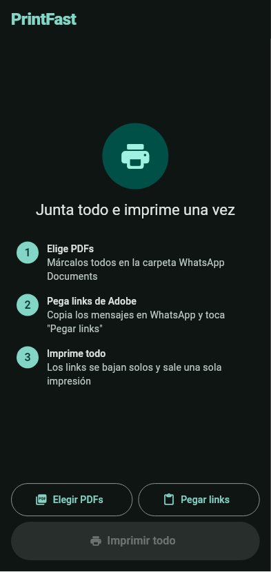

# PrintFast

App Android para imprimir de una sola vez los PDFs y links de Adobe Acrobat que te mandan por WhatsApp.

<p>
  
  
</p>

**Descarga:** el APK está en [Releases](../../releases/latest).

## Cómo se usa

1. **PDFs:** toca **Elegir PDFs** y marca varios a la vez en la carpeta `WhatsApp Documents` (Almacenamiento interno → Android → media → com.whatsapp → WhatsApp → Media), o en "Recientes". WhatsApp solo deja compartir un documento a la vez, pero también puedes hacerlo: Compartir → **PrintFast**. Los PDFs tienen que estar descargados en WhatsApp.
2. **Links de Adobe** (`https://acrobat.adobe.com/id/urn:...`): selecciona los mensajes → Copiar → en PrintFast toca **Pegar links**. También puedes compartir un mensaje con link directo a PrintFast.
3. Toca **Bajar de Adobe**: la app abre cada link y baja el PDF sola.
4. Toca **Imprimir todo**: se juntan todos los PDFs en uno y se abre el diálogo de impresión de Android una sola vez.

Necesitas una impresora ya configurada en el teléfono (Ajustes → Impresión).

## Cómo funciona lo de Adobe

El visor de Adobe baja el PDF desde una URL firmada apenas carga la página. PrintFast abre el link en un WebView, busca esa URL en `performance.getEntriesByType('resource')` y la descarga. No usa cuenta de Adobe. Si Adobe cambia su visor, el ajuste se hace en `lib/adobe_fetch.dart`.

## Compilar

```bash
flutter pub get
flutter test
flutter build apk --release
```

El APK queda en `build/app/outputs/flutter-apk/app-release.apk`. Se firma con la clave de depuración, así que sirve para instalarlo a mano pero no para Play Store.

## Licencia

MIT
